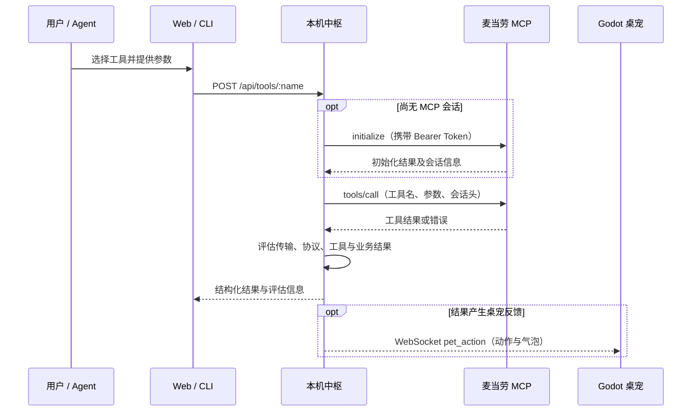

# 麦当劳 MCP 接入说明

## 使用的服务与实现入口

本项目通过本机 Hono 中枢服务请求麦当劳中国 MCP Server，Web 控制台和 CLI 使用本地 HTTP API，Godot 桌宠通过 WebSocket 接收动作与气泡反馈。

| 项目 | 当前实现 |
|:---|:---|
| MCP Server | 麦当劳中国 MCP Server |
| 默认地址 | `https://mcp.mcd.cn/mcp-servers/mcd-mcp` |
| 地址配置 | `MCD_MCP_ENDPOINT` 或本地中枢配置中的 `mcpEndpoint` |
| 请求方式 | HTTP POST、JSON-RPC 2.0；当前网关解析 JSON 响应 |
| 鉴权 | `Authorization: Bearer ${MCD_MCP_TOKEN}`，运行时使用用户自己的 Token |
| MCP 方法 | `initialize`、`tools/list`、`tools/call` |
| 会话 | 捕获官方返回的 `Mcp-Session-Id`，在后续请求中携带 |

接入依据：[麦当劳 MCP 官方使用指南](https://github.com/M-China/mcd-mcp-server)。官方当前公开的接入地址为 `https://mcp.mcd.cn`，本仓库当前默认值带有 `/mcp-servers/mcd-mcp` 路径，两者应区分。若默认地址无法使用，可通过上述配置项改为官方公布的地址；实际兼容性需通过真实查询验证。官方能力、账号权限和实际返回可能变化。

主要实现文件：

- [MCP 网关](server/src/mcp/client.ts)：鉴权、初始化、工具发现、真实调用与模拟分支。
- [本地工具 API](server/src/routes/tools.ts)：Web / CLI 请求入口、结果格式化与桌宠反馈。
- [工具元数据](shared/src/constants/tools.ts)：前后端共用的 33 项内置工具定义。
- [业务结果评估](shared/src/utils/evaluator.ts)：区分传输、JSON-RPC、工具执行与业务结果。
- [WebSocket 中心](server/src/ws/hub.ts)：广播桌宠动作和气泡。
- [Web 客户端](web/src/services/mcpClient.ts)、[CLI 工具命令](cli/src/commands/tools.ts)、[Agent Skill](skill/SKILL.md)：用户和 Agent 的调用入口。

## 工具与业务价值

以下是代码中接入的工具入口，按内置目录分类。该清单表示项目具备对应的调用入口，不表示所有工具均已在当前账号上完成线上验证；运行时可调用 `tools/list` 查询官方工具描述与参数。

| 场景 | MCP Tool 标识 | 业务价值 |
|:---|:---|:---|
| 营养查询 | `list-nutrition-foods` | 查询餐品营养信息，辅助用户了解餐品 |
| 时间与活动 | `campaign-calendar`、`now-time-info` | 查看活动日历与时间信息 |
| 优惠券 | `available-coupons`、`auto-bind-coupons`、`query-my-coupons`、`query-store-coupons` | 查询可领券、领取优惠券、查看个人及门店可用券 |
| 点餐与外送 | `delivery-query-addresses`、`delivery-create-address`、`delivery-query-stores`、`query-meal-assistance`、`query-nearby-stores`、`query-meals`、`query-meal-detail`、`calculate-price`、`create-order`、`cancel-order`、`query-order`、`order-list` | 提供地址、门店、餐品、试算及订单操作入口 |
| 积分与商城 | `query-my-account`、`mall-points-products`、`mall-product-detail`、`mall-create-order`、`mall-order-list`、`mall-order-detail` | 查询积分、浏览商品及操作商城订单 |
| 积分抽奖 | `query-lottery-info`、`draw-lottery`、`query-my-prizes` | 查询活动、参与抽奖及查看奖品 |
| 主题活动 | `query-party-city`、`query-party-store`、`query-partystore-date`、`query-partystore-session`、`party-order-create` | 查询活动城市、门店、日期与场次，提供预约订单入口 |

本项目的业务组合是“桌面提醒 + MCP 查询 / 操作 + 桌宠反馈”。用户可以在午休前查询优惠和餐品信息，操作结果会转为桌宠表现；详情仍可在控制台查看。下单、兑换等操作按用户主动执行的工具请求触发，午休提醒不会自动发起这些操作。

## 真实调用流程



例如 Web 中查询巨无霸营养时，会向本地 `POST /api/tools/list-nutrition-foods` 提交 `{"keyword":"巨无霸"}`。网关将其转为以下 JSON-RPC 请求；`id` 在运行时生成：

```json
{
  "jsonrpc": "2.0",
  "id": 1,
  "method": "tools/call",
  "params": {
    "name": "list-nutrition-foods",
    "arguments": { "keyword": "巨无霸" }
  }
}
```

中枢返回的 `layers` 包含 `transport`、`rpc`、`tool`、`business` 四层结果。HTTP 成功不等于业务成功；领券可能完全成功、部分成功或失败，桌宠反馈由评估结果决定。前端展示实际结果，不以固定成功文案代替官方响应。

## 配置与凭证存储

[mcp-config.example.json](mcp-config.example.json) 采用 MCP 客户端连接配置结构，地址和鉴权值使用环境变量占位符：

- `MCD_MCP_ENDPOINT`：本项目默认官方地址为 `https://mcp.mcd.cn/mcp-servers/mcd-mcp`。
- `MCD_MCP_TOKEN`：用户从[麦当劳开放平台](https://open.mcd.cn/mcp)申请的个人 Token。

该 JSON 是脱敏配置示例，本项目中枢不会自动读取它。外部 MCP 客户端使用时，需要依据客户端自身的配置规范展开环境变量；请勿将含真实凭证的展开结果提交到仓库。

本项目实际使用以下配置方式：

| 入口 | Token 配置与存储 |
|:---|:---|
| Web | 顶部输入框自动保存到当前浏览器的 `localStorage`（键为 `mcd_mcp_token`），请求时作为 Bearer Token 发往本机中枢 |
| 中枢 / CLI | 启动中枢前设置 `MCD_MCP_TOKEN`，或使用 CLI 的 `config set-token` 持久化到 `~/.mcd-desktop-pet/config.json` |
| MCP 地址 | 启动前设置 `MCD_MCP_ENDPOINT`，或使用中枢配置中的 `mcpEndpoint`；未配置时使用默认官方地址 |

Web 请求头中的 Token 优先于中枢 Token。中枢先读取环境变量默认值，再合并已有 `config.json`，因此已有文件中的同名配置会覆盖环境默认值。Web Token 和中枢 Token 独立保存；仅在网页输入 Token 不会为 CLI 配置凭证。

在 macOS / Linux 发布包目录中，如果当前终端已设置 `MCD_MCP_TOKEN`，可将其写入中枢配置：

```bash
./mcd config set-token "${MCD_MCP_TOKEN:?请先设置 MCD_MCP_TOKEN}" --json
```

该命令要求中枢已运行。源码模式先执行 `pnpm build:cli`，再将 `./mcd` 替换为 `pnpm cli`。Windows 使用 `.\mcd.bat` 和 PowerShell 对应的环境变量语法。Token 会被发送给配置的 MCP 服务进行鉴权；请核对服务地址，且不要在截图、日志或提交材料中包含凭证、个人地址或真实订单信息。

## 复现与验证

### 真实 MCP 查询

1. 按 [README](README.md#开发者快速启动-源码运行) 启动中枢、控制台及可选的桌宠。
2. 在 Web 顶部配置个人 Token，点击“测试连接”。该操作请求本地 `/api/tools/initialize`，再由网关调用官方 `initialize`。
3. 选择 `list-nutrition-foods`，提交 `keyword=巨无霸`；或选择 `campaign-calendar`，查询活动日历。
4. 确认页面返回本次官方查询结果，并检查四层结果及桌宠反馈。Token 或权限不符合要求时，应展示失败原因。

也可在已设置 `MCD_MCP_TOKEN` 的 macOS / Linux 终端中，直接请求本机通用工具入口：

```bash
curl --fail-with-body http://localhost:23301/api/tools/list-nutrition-foods \
  -H "Authorization: Bearer ${MCD_MCP_TOKEN:?请先设置 MCD_MCP_TOKEN}" \
  -H 'Content-Type: application/json' \
  --data '{"keyword":"巨无霸"}'
```

这是一次真实查询请求，不使用模拟参数。返回内容可能随官方服务变化，本文不提供伪造的“线上成功”响应。文档整理时仅核对代码接入路径，未使用个人 Token 进行线上验证。

### 本地模拟演示

保持中枢与桌宠运行，执行 `pnpm mock:lunch`（需 Python 3.10+）。[模拟脚本](scripts/mock-lunch-scenario.py)向 `/api/pet/action` 推送预设动作与气泡，并通过 `/api/tools/simulate` 生成领券、营养与下单的模拟结果。

六步场景中的优惠、套餐、订单号、配送进度与送达信息均为演示内容，不创建真实订单，也未实现真实配送状态订阅。正常午休定时器只触发提醒，不会自动串联领券或下单。

`/api/tools/simulate` 以及显式指定 `x-mock-scenario` 请求头或 `mock` 查询参数的请求用于本地测试；正常 Web 工具请求不指定这些参数。工具发现失败时，`GET /api/tools` 可以返回内置目录。

## 参赛材料对应关系

本文用于说明实际接入的 Server、Tool、调用流程和业务价值；项目介绍、目标用户和安装方法见 [README](README.md)，官方原文声明见 [CONTEST_DECLARATION.md](CONTEST_DECLARATION.md)。材料要求依据[比赛说明](https://github.com/M-China/mcd-developer-innovation-challenge)与[完整活动规则](https://github.com/M-China/mcd-developer-innovation-challenge/blob/main/activityGuidelines.md)。
