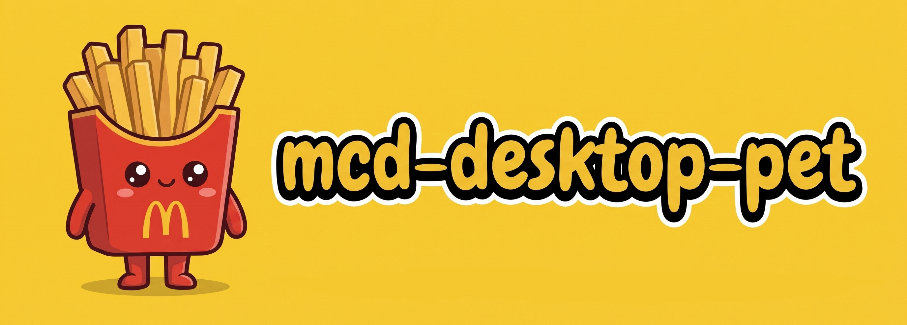
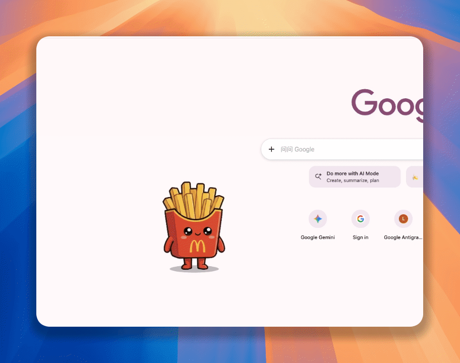
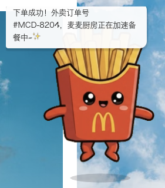
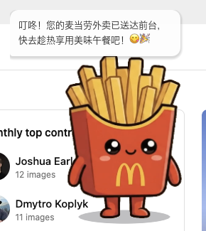
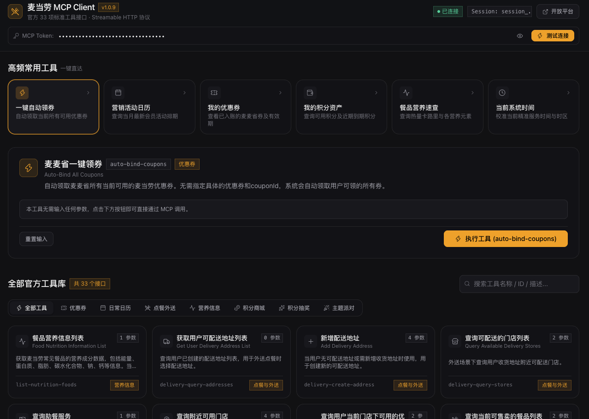

# mcd-desktop-pet



一只生活在电脑桌面角落的麦当劳“薯条小宝”桌面宠物。

它不仅能在你的桌面上闲庭漫步、接受摸头互动，还是一位麦麦生活管家——定时提醒午餐、一键领取优惠券、查询餐品营养信息，并通过网页控制台调用麦当劳 MCP 服务。项目目前内置 33 项工具定义，实际可用能力以官方服务返回及账号权限为准。

本项目为麦当劳程序员创意开发大赛参赛作品，由开发者独立开发，非麦当劳官方产品。

## 目标用户与使用场景

- **日常使用电脑的办公与学习用户**：通过桌面陪伴和午休提醒，及时安排用餐与休息。
- **希望便捷获取麦当劳服务的用户**：通过图形界面查询优惠券、活动、餐品营养和积分，减少手动组织工具参数的操作。
- **使用 AI Agent 的开发者**：通过项目提供的 [Skill](skill/SKILL.md) 和 CLI，将自然语言需求转为 MCP 工具调用，并让桌宠展示业务反馈。

项目将 MCP 业务结果连接到桌宠动作与对话气泡，让信息查询和任务执行有直观反馈；网页控制台用于查看详细数据和手动调用工具。

---

## 桌面宠物：薯条小宝



薯条小宝会静静地在桌面陪伴你，带来轻松有趣的工作与休闲氛围：

### 互动与表演

- **互动动画**：鼠标左键轻点小宝，它会开心地向上弹跳，并冒出元气满满的对话气泡。在闲暇时，它会在桌面边走边散步。
- **动作随心控**：在小宝身上点击鼠标右键，可以随时命令它“散步走走”、“停下休息”、“开怀跳跃”或“挥手打招呼”。
- **自由拖拽**：按住鼠标左键即可随时将它移至屏幕任意位置，不影响你的日常打字与办公。

### 贴心午餐提醒

- **饭点报时**：内置智能午餐闹钟，默认每天 12:00 提前 10 分钟提醒你该选餐休息啦。
- **个性化设置**：右键菜单中支持快速选择 11:30、12:00、12:30 等多个预设时段，也可以输入任意自定义时间与提前提醒分钟数。
- **即时测试**：在右键菜单中点击“立即测试午休提醒”，随时预览小宝的报时与互动动作。
- **午餐场景模拟演示**：以下六步展示桌宠的动作与气泡反馈效果：

| 步骤 1：午休提醒 | 步骤 2：优惠领券 | 步骤 3：餐品推荐 |
|:---|:---|:---|
|  |  |  |
| **步骤 4：确认下单** | **步骤 5：配送动态** | **步骤 6：外卖送达** |
|  |  |  |

以上六步由模拟脚本驱动，优惠券、餐品推荐、下单、配送与送达均使用预设内容或模拟结果，复现方式见下文“模拟演示”。

Web 控制台的常规工具调用通过本地中枢连接麦当劳 MCP，真实调用与模拟入口的区别见 [MCP 接入说明](MCP_INTEGRATION.md)。项目架构和流程还在优化中，欢迎提出 Issue 和 PR。

### 视窗设计

- **全屏显示设置**：支持右键开启和关闭“在全屏应用中显示桌宠”，是否让小宝陪你全屏看视频或沉浸办公，由你选择。

---

## 配套图形控制台 (Web Console)

如果你需要更深度的麦当劳服务，只需在桌宠身上右键选择 **“打开 Web 控制台”**，即可一键呼出图形化管理界面：



控制台提供以下 MCP 工具入口，调用结果由麦当劳官方服务返回：

- **一键省钱领券**：自动领取当前可用的麦当劳麦麦省券，并可随时查看手头卡券列表与到期日期。
- **当季活动日历**：同步当月麦当劳最新的营销日历，随时了解即将开启的促销与限定新品。
- **餐品营养速查**：输入餐品关键词，查看官方返回的能量、蛋白质、脂肪等营养信息。
- **积分与周边商城**：快速查看账户麦当劳积分余额，参与在线积分抽奖与周边兑换。
- **附近门店与点餐**：快速查询周边可用的麦当劳门店及支持的服务状态。
- **更多工具**：主题活动预约、订单查询等，完整内置工具清单见 [MCP 接入说明](MCP_INTEGRATION.md#工具与业务价值)。

---

## 快速使用指南

### 下载与启动

先安装 **Node.js 22**（与项目 CI 使用的版本一致），并确认终端执行 `node --version` 能显示版本号。发布包中的中枢服务与 CLI 仍需 Node.js；运行已打包的桌宠无需安装 Godot 或 pnpm。

从项目的 [Releases 页面](https://github.com/kv-chiu/mcd-mcp-webui/releases)下载对应系统的压缩包。若尚无对应版本的发布包，请使用下文的源码运行方式。

#### Windows 系统

1. 解压下载的压缩包文件夹。
2. 双击运行 `start.bat`，桌宠将出现在桌面右下角。
3. 启动脚本会同时启动中枢服务并打开控制台，默认地址为 `http://localhost:3001`。
4. 双击 `stop.bat` 停止整套服务；桌宠右键“退出桌宠”仅用于退出桌宠客户端。

#### macOS 系统

1. 解压下载的压缩包文件夹。
2. 在终端进入解压目录，运行 `./start.sh`，启动中枢、桌宠和浏览器控制台（默认 `http://localhost:3001`）。
3. 直接打开 `McdDesktopPet.app` 只启动桌宠客户端；使用 MCP 或 Web 控制台前仍需启动中枢服务。
4. 运行 `./stop.sh` 停止整套服务。

#### Linux 系统

1. 解压对应的 `.tar.gz` 发布包，在有图形桌面的环境中进入解压目录。
2. 运行 `./start.sh` 启动中枢与桌宠，访问 `http://localhost:3001` 打开控制台。
3. 运行 `./stop.sh` 停止整套服务。

### 首次配置（麦当劳 Token）

为了让小宝能够为你查询卡券与积分，启动后打开 Web 控制台：

1. 访问 [麦当劳开放平台 (open.mcd.cn)](https://open.mcd.cn/mcp) 获取你的个人 MCP Token。
2. 将 Token 填入 Web 控制台顶部的输入框；输入会自动保存到当前浏览器的本地存储，无需点击保存。
3. 点击“测试连接”，确认状态变为“已连接”后再执行工具。

Web Token 保存在当前浏览器的 `localStorage` 中，调用时随请求发送到本机中枢，再由中枢携带 Token 请求配置的麦当劳 MCP 地址。CLI 使用独立的中枢配置；Web 中输入 Token 不会自动同步给 CLI。配置方式见 [MCP 接入说明](MCP_INTEGRATION.md#配置与凭证存储)。

### 使用示例：查询餐品营养

1. 按上述步骤启动服务并配置 Token，完成“测试连接”。
2. 在控制台选择 `list-nutrition-foods`（餐品营养信息列表）。
3. 将 `keyword` 填为“巨无霸”，点击“执行工具”。
4. 查看结果区的餐品营养信息；桌宠连接到中枢时，会根据业务评估结果展示相应动作与气泡反馈。

实际数值以本次官方返回为准。若请求失败，先检查 Token、网络与页面错误信息；工具清单能够显示不代表已完成真实 MCP 调用。

### AI Agent 与 CLI

项目提供 [Skill 使用文档](skill/SKILL.md)。将该技能交给支持 Skill 的 Agent 后，可以用“查询巨无霸的营养信息”“帮我领取可用优惠券”等自然语言表达需求，由 Agent 调用本地 CLI。

在 macOS / Linux 发布包目录中，可以直接运行：

```bash
./mcd nutrition 巨无霸 --json
./mcd calendar --json
```

Windows 对应使用 `.\mcd.bat`。这些业务命令要求中枢服务已启动，并已通过 CLI 或环境变量配置中枢 Token，详见 [MCP 接入说明](MCP_INTEGRATION.md#配置与凭证存储)。

---

## 常用操作速查

| 操作 | 对应效果 |
|:---|:---|
| **鼠标左键单击** | 摸头互动，触发弹跳动画与随机对话气泡 |
| **鼠标左键按住拖动** | 将桌宠移动至屏幕任意位置 |
| **鼠标右键单击** | 打开控制菜单（动作指令、午休设置、控制台入口） |

---

## 常见问题 (FAQ)

**Q: 桌宠会遮挡我的日常工作或打字吗？**

A: 不会。桌宠仅占用屏幕角落的一小块区域，你可以随时将它拖到屏幕任意角落。如果你在做重要全屏演示，可在右键菜单中取消勾选“在全屏应用中显示桌宠”，或者直接右键退出。

**Q: 我完全不懂代码，可以直接用吗？**

A: 可以。安装 Node.js 22 后，下载对应系统的发布包并运行启动脚本即可。打包版本无需编译代码，日常操作可以通过鼠标完成。

**Q: Token 保存在哪里？**

A: Web Token 保存在当前浏览器的 `localStorage`；通过 CLI 持久化的 Token 保存在 `~/.mcd-desktop-pet/config.json`。业务请求经本机中枢转发到配置的 MCP 地址。清空网页 Token 输入框可移除该处保存的 Token，不会同时删除中枢配置。请勿将真实 Token、个人地址或订单信息提交到仓库、Issue 或演示截图中。

---

## 开发者快速启动 (源码运行)

如果你是开发者并希望从源码运行或二次开发：

准备 Node.js 22、pnpm 12.10.1（版本见 `package.json`）；运行桌宠还需安装 Godot 4.x，并确保终端可执行 `godot --version`。仅使用 Web 控制台时无需 Godot。

先克隆仓库并构建共享包与控制台：

```bash
git clone https://github.com/kv-chiu/mcd-mcp-webui.git
cd mcd-mcp-webui
pnpm install
pnpm --filter @mcd/shared build
pnpm build:web
```

随后在仓库根目录的终端 A 启动中枢服务，并保持运行：

```bash
pnpm dev:server
```

浏览器访问 `http://localhost:3001`，按“首次配置”设置 Token。另开终端 B，进入同一仓库根目录后启动桌宠：

```bash
pnpm dev:desktop
```

修改前端代码时，可另开终端 C 运行开发服务器，访问 `http://localhost:8080`；此时终端 A 的中枢服务仍需运行：

```bash
pnpm dev:web
```

源码模式使用 CLI 前，先执行 `pnpm build:cli`，随后可用 `pnpm cli --help` 查看命令。

### 模拟演示

需要 Python 3.10 或更高版本。保持中枢与桌宠运行，在仓库根目录的另一个终端执行：

```bash
pnpm mock:lunch
```

该命令调用本地模拟接口演示六步午餐场景，无需真实 Token，不会调用官方下单接口。

---

## 参赛材料

本项目依据[比赛说明](https://github.com/M-China/mcd-developer-innovation-challenge)及[完整活动规则](https://github.com/M-China/mcd-developer-innovation-challenge/blob/main/activityGuidelines.md)准备以下材料：

| 文件 | 内容 |
|:---|:---|
| [README.md](README.md) | 项目介绍、目标用户、安装方法与使用示例 |
| [CONTEST_DECLARATION.md](CONTEST_DECLARATION.md) | 官方参赛声明，保留原始内容 |
| [MCP_INTEGRATION.md](MCP_INTEGRATION.md) | MCP Server、工具、调用流程、业务价值与验证方法 |
| [mcp-config.example.json](mcp-config.example.json) | 仅用环境变量占位符配置地址与凭证的 MCP 配置示例 |

---

## 许可证

项目代码基于 [MIT License](LICENSE) 开源。麦当劳相关商标与素材的权利归其权利人所有，不因代码许可证而转移。项目输出仅供参考，不构成医疗、营养或其他专业建议；餐品信息、价格及供应状态以麦当劳官方渠道的实时结果为准。
